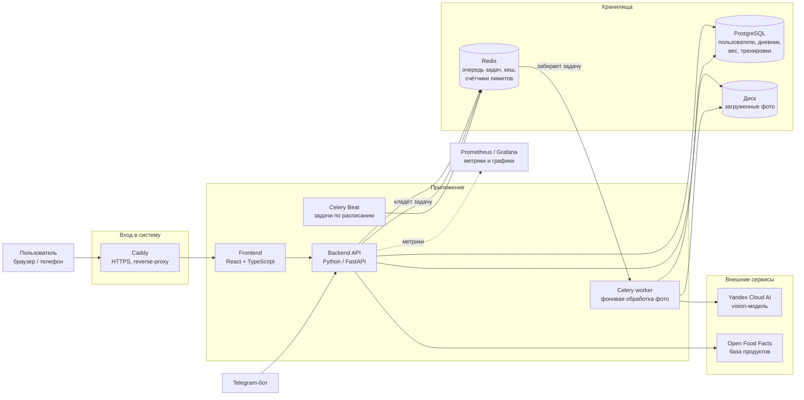
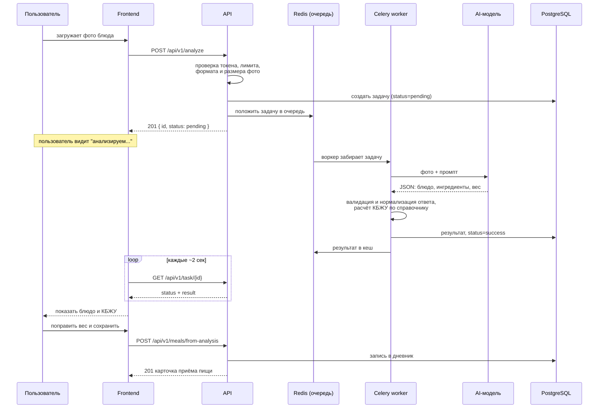
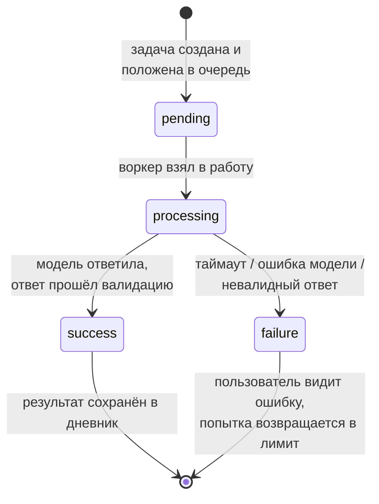
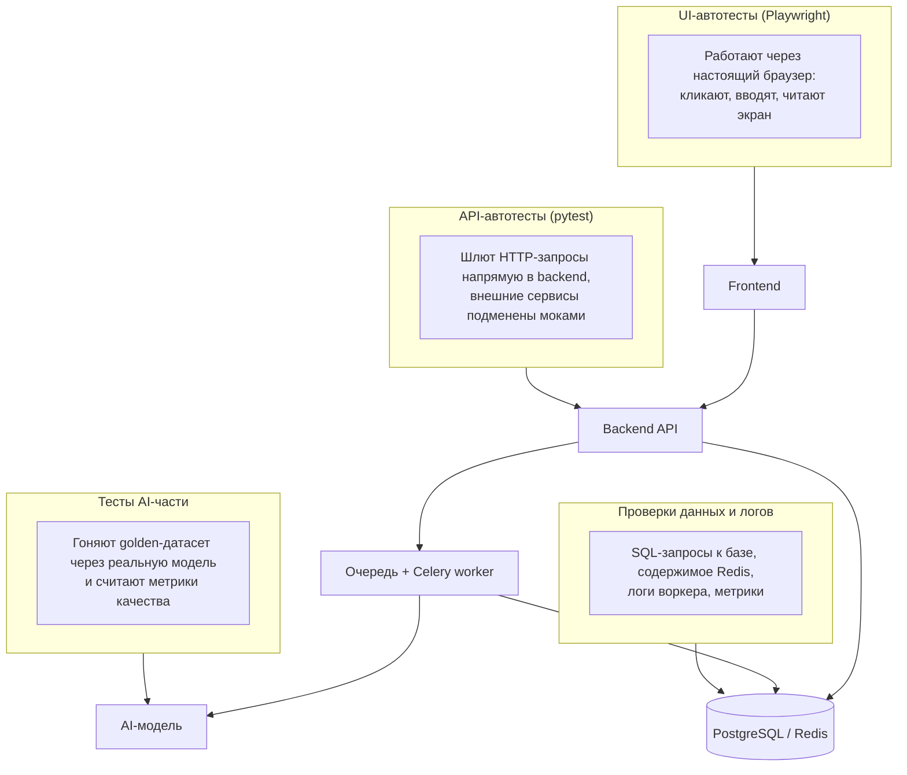
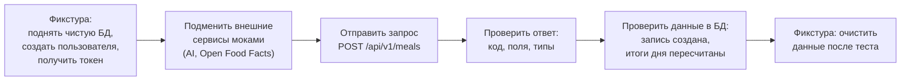
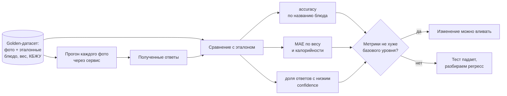
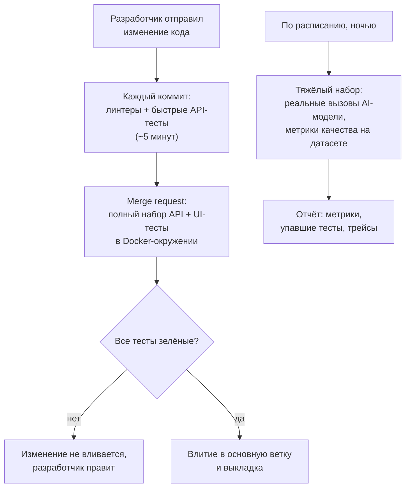
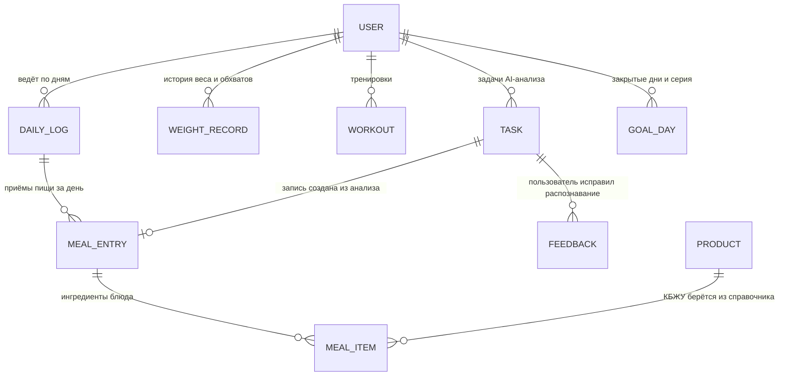

# AI-Healthy: гайд по проекту и работе Fullstack QA Automation

Документ написан простым языком: сначала — что за продукт и из чего он собран (с расшифровкой всех технических слов), потом — что именно делал QA и какие автотесты написал.

---

## Часть 1. Что за продукт

**AI-Healthy** — приложение для контроля питания. Главная идея: не нужно вручную искать калорийность в справочниках. Пользователь фотографирует тарелку, приложение само распознаёт блюдо, определяет состав и вес, считает калории и БЖУ (белки, жиры, углеводы) и записывает приём пищи в дневник.

Что умеет приложение:

- **AI-анализ фото еды.** Загрузил фото → через 20–40 секунд получил название блюда, список ингредиентов, вес и КБЖУ. Можно поправить результат и сохранить в дневник.
- **Сканер штрих-кода.** Сфотографировал упаковку → приложение достаёт продукт из открытой базы Open Food Facts и подставляет КБЖУ на 100 г.
- **Ручной ввод** из справочника продуктов с автодополнением.
- **Дневник дня**: завтрак, обед, ужин, перекусы, итоги по калориям и БЖУ, сравнение с личной нормой.
- **Вода**: учёт выпитого за день с нормой.
- **Тренировки**: справочник упражнений, сожжённые калории, недельная активность.
- **Профиль и вес**: рост, пол, возраст, уровень активности, история веса и обхватов, графики. Приложение считает норму калорий под цель (похудеть / удержать / набрать).
- **Цели и «серия»** — геймификация: закрыл цели дня → день засчитан, копится серия дней подряд, есть «заморозки», чтобы не потерять серию из-за одного пропуска.
- **AI-советчик**: текстовые рекомендации по питанию на основе данных пользователя.
- **Telegram-бот** — упрощённый сценарий: прислал фото боту, получил разбор.

---

## Часть 2. Из чего собран проект (и что означает каждое слово)

Приложение состоит из нескольких независимых частей — микросервисов. Микросервис — это отдельная программа, отвечающая за свой кусок работы; они общаются между собой по сети. Так удобнее: упал один кусок — остальные живут.

### Составные части

| Часть | Что это простыми словами |
|---|---|
| **Frontend (React + TypeScript)** | То, что пользователь видит в браузере: кнопки, формы, графики. React — библиотека для сборки интерфейса из блоков-компонентов. TypeScript — тот же JavaScript, но с проверкой типов данных, чтобы меньше ошибаться. |
| **Backend / API (Python + FastAPI)** | «Мозг» приложения: принимает запросы от интерфейса, проверяет права, считает нормы, ходит в базу. FastAPI — фреймворк на Python для написания веб-API. |
| **API (REST)** | Способ общения интерфейса с сервером: интерфейс отправляет запрос по адресу вроде `POST /api/v1/meals` с данными в формате JSON, сервер отвечает JSON'ом и кодом статуса (200 — ок, 401 — не авторизован, 404 — не найдено, 500 — ошибка сервера). |
| **Swagger / OpenAPI** | Автоматически сгенерированная документация API: список всех адресов, какие поля принимают и что возвращают. Для QA — главный источник правды и удобная «песочница» для ручных запросов. |
| **PostgreSQL** | База данных, где лежат пользователи, приёмы пищи, вес, тренировки. Данные хранятся в таблицах, читаются языком SQL. |
| **Alembic** | Инструмент миграций — то есть управляемого изменения структуры базы (добавили колонку, создали индекс). Чтобы на сервере схема обновлялась предсказуемо, а не руками. |
| **Redis** | Быстрое хранилище «в памяти». Здесь: кеш результатов анализа фото, счётчики лимитов (сколько анализов пользователь потратил за день), учёт активных токенов, очередь задач. |
| **Celery** | Система фоновых задач. Анализ фото занимает полминуты — держать пользователя всё это время на «крутилке» нельзя. Поэтому API просто кладёт задачу в очередь и сразу отвечает «принято, вот id задачи». Отдельная программа — **Celery worker** — берёт задачу из очереди, гоняет фото через AI-модель и записывает результат. Интерфейс тем временем каждые пару секунд спрашивает: «задача 123 готова?». |
| **Celery Beat** | Планировщик: запускает задачи по расписанию (например, ночная уборка старых загруженных фото). Аналог cron. |
| **Брокер сообщений** | Посредник, через которого передаются задачи между API и воркером. В этом проекте роль брокера играет Redis. В других проектах для этого используют Kafka или RabbitMQ — принцип тот же. |
| **Vision-модель / LLM** | «Искусственный интеллект», который смотрит на фото и описывает, что на нём. Vision-модель — модель, умеющая работать с картинками. LLM (large language model) — большая языковая модель. Здесь используется облачный сервис Yandex Cloud AI: сервис отправляет модели картинку и **промпт** (текстовую инструкцию — что именно вернуть и в каком формате), модель отвечает JSON'ом. |
| **Промпт** | Текстовая инструкция для модели. У промпта есть версия (`v15` и т.д.): меняем инструкцию → повышаем версию → старый кеш ответов перестаёт использоваться. |
| **Open Food Facts** | Внешняя открытая база продуктов, откуда берутся данные по штрих-коду. |
| **JWT-токен** | «Пропуск» пользователя. После входа сервер выдаёт два токена: **access** — короткоживущий, прикладывается к каждому запросу; **refresh** — долгоживущий, нужен только чтобы получить новый access, когда старый протух. |
| **Docker / Docker Compose** | Контейнеризация: каждая часть приложения упакована в изолированную «коробку» со всеми зависимостями. Docker Compose одной командой поднимает сразу все коробки — базу, Redis, API, воркер, фронт. Для QA это значит, что полное окружение разворачивается локально за пару минут. |
| **Caddy** | Веб-сервер перед приложением: принимает запросы из интернета, выдаёт HTTPS-сертификаты, раздаёт фронтенд. Такую штуку называют reverse-proxy. |
| **Prometheus / Grafana** | Мониторинг: Prometheus собирает метрики (сколько запросов, сколько миллисекунд отвечал каждый эндпоинт, сколько ошибок), Grafana рисует по ним графики. |
| **CI / CD** | Автоматика вокруг кода: при каждом изменении сервер сам собирает проект и прогоняет тесты. Упали тесты — изменение не вливают. |
| **pytest** | Основной фреймворк для автотестов на Python. |
| **Playwright** | Инструмент, который управляет настоящим браузером из кода: открывает страницу, кликает, вводит текст, проверяет что появилось на экране. Используется для UI-автотестов. |
| **Page Object** | Подход к написанию UI-тестов: для каждой страницы делается класс с её элементами и действиями. Поменялась кнопка — правим в одном месте, а не в тридцати тестах. |
| **TestOps / TMS** | Система управления тестами: хранит тест-кейсы, связывает их с автотестами, показывает историю прогонов и покрытие. |

### Схема: как всё соединено

Читать так: пользователь всегда общается только с API. Тяжёлую работу (анализ фото) API не делает сам — он передаёт её через Redis воркеру, а воркер уже ходит в AI-сервис.

### Как работает главный сценарий (важно для понимания тестов)

1. Пользователь загружает фото → `POST /api/v1/analyze`.
2. API проверяет: авторизован ли пользователь, не исчерпан ли дневной лимит анализов, действительно ли это картинка допустимого формата и разумного размера.
3. Фото приводится к единому виду: разворачивается по EXIF (метаданные телефона о повороте кадра), конвертируется в JPEG, сжимается.
4. API создаёт задачу в базе, кладёт её в очередь и **сразу** возвращает `id` задачи со статусом «в работе».
5. Celery-воркер забирает задачу, отправляет фото в AI-модель с промптом, получает JSON с блюдом и ингредиентами.
6. Ответ модели проверяется и нормализуется: типы ингредиентов приводятся к допустимому списку, ингредиенты ищутся в справочнике продуктов, считается КБЖУ, отсекается нереалистичная калорийность.
7. Результат кладётся в базу и в кеш Redis. Статус задачи меняется на SUCCESS или FAILURE.
8. Интерфейс поллит `GET /api/v1/task/{id}`, показывает результат, пользователь при желании правит и сохраняет в дневник.

### Схема: главный сценарий по шагам

### Схема: жизненный цикл задачи анализа

Именно из-за этой цепочки тестирование здесь сложнее обычного CRUD: результат приходит асинхронно, зависит от внешнего сервиса и **недетерминирован** — то есть на одно и то же фото модель может ответить чуть по-разному.

---

## Часть 3. Чем занимался Fullstack QA Automation

«Fullstack QA» здесь означает, что человек закрывает продукт целиком: и серверную часть (API, база, очереди, интеграции с AI), и веб-интерфейс, и ручные проверки, и документацию, и автоматизацию.

### Схема: какой тест куда «бьёт»

Логика простая: чем ниже уровень, тем быстрее и стабильнее тест, поэтому основную массу проверок закрывают API-тесты, а UI-тестами проходят только реальные пользовательские сценарии.

### 3.1. Работа с требованиями и документацией

- Разбор задач и требований до начала разработки: какие поля обязательны, что происходит на границах, какие ошибки должен видеть пользователь. Найденные противоречия возвращались аналитику и разработчику — это дешевле, чем ловить их потом в баге.
- Декомпозиция задачи на тестовые сценарии: одна фича превращается в список конкретных проверок.
- Ведение тест-кейсов и чек-листов по модулям (авторизация, дневник, AI-анализ, штрих-коды, вода, тренировки, профиль, цели), поддержание их в актуальном состоянии после каждого релиза.
- Сверка реального поведения API со Swagger-схемой: если сервер отдаёт поле, которого нет в документации, или наоборот — это дефект документации, его тоже заводят.
- Поддержка Postman-коллекции со всеми запросами и окружениями (локальное / тестовое), чтобы любой в команде мог быстро дёрнуть нужный эндпоинт.
- Баг-репорты: шаги воспроизведения, ожидаемый и фактический результат, логи, окружение, приоритет. Ретест после фикса и регресс вокруг затронутой области.

### 3.2. Автотесты API (pytest)

Основа — pytest с фикстурами (подготовка данных перед тестом и уборка после), параметризацией (один тест прогоняется на десятке наборов входных данных) и моками внешних сервисов (подмена реального вызова AI-модели и Open Food Facts заглушкой, чтобы тесты были быстрыми, стабильными и бесплатными). Запросы — через httpx / FastAPI TestClient.

Схема одного типового API-теста:

**Регистрация и вход**

- Регистрация с валидными данными: пользователь создан, код `201`, пароль в ответе не возвращается.
- Повторная регистрация того же email → `400`.
- Невалидные email и слабые пароли → ошибка валидации `422`, с понятным описанием поля.
- Вход с верным паролем → выдаются access и refresh токены; вход с неверным → `401` и одинаковый текст ошибки независимо от того, существует ли такой email (чтобы нельзя было перебором узнать список пользователей).
- Вес, указанный при регистрации, автоматически становится первой записью в истории взвешиваний — проверка через `GET /api/v1/profile/weight-history`.

**Токены и сессии**

- Запрос к защищённому эндпоинту без токена / с мусорным токеном / с истёкшим токеном → `401`.
- Обновление пары токенов по refresh: новый access работает.
- Refresh одноразовый: повторное использование того же refresh-токена → `401` и принудительное завершение всех сессий пользователя (защита от кражи токена).
- Смена пароля: старые access и refresh перестают работать сразу, в ответе приходит свежая пара — текущая сессия не разлогинивается.
- Смена пароля с неверным текущим паролем → `400`; новый пароль, совпадающий со старым → `400`.

**Права доступа (самая критичная группа)**

Создаются два пользователя, и второй пытается дотянуться до данных первого:

- Чужой `task_id` в `GET /api/v1/task/{id}` → `404` (именно 404, а не 403 — чтобы не подтверждать существование объекта).
- Чужой `meal_id` в редактировании, удалении, загрузке фото к приёму пищи → `404`.
- Чужая запись веса, чужой `workout_id` → `404`.
- Попытка привязать к своему приёму пищи чужой `task_id` при создании записи → `404`. Это ключевой кейс: без проверки владения через такую запись можно было бы получить ссылку на чужое фото.
- Обращение к админским эндпоинтам (`/api/v1/admin/feedback`) обычным пользователем → отказ.
- Прямое обращение к файлу фото по ссылке без подписи или с истёкшим сроком подписи → отказ.

**Лимиты и защита от перебора**

- Дневной лимит AI-анализов: N успешных запросов проходят, следующий → `429`; счётчик виден в `GET /api/v1/analyze/limit`.
- Если загружен битый файл или упала постановка задачи — попытка **возвращается** обратно в лимит (пользователь не должен терять анализ из-за ошибки сервиса).
- Серия неверных паролей → временная блокировка пары (email + IP); после успешного входа счётчик сбрасывается.
- Лимит регистраций с одного IP.
- Проверка, что лимиты нельзя обойти подстановкой заголовка `X-Forwarded-For` (заголовок, которым клиент может пытаться притвориться другим IP).

**Загрузка файлов**

- Валидные форматы: JPEG, PNG, WEBP, HEIC (формат фото с iPhone) — принимаются.
- Файл с расширением `.jpg`, внутри которого не картинка → `400` (проверяется содержимое, а не имя файла).
- Файл без расширения, но валидная картинка внутри — принимается (реальный кейс браузеров на iOS).
- Превышение максимального размера → `413`.
- Картинка с гигантским разрешением («бомба сжатия», способная съесть всю память сервера) → `400`.
- Фото с EXIF-поворотом сохраняется уже развёрнутым — иначе модель видит блюдо повёрнутым на 90°.
- После неуспешной загрузки временные файлы не остаются на диске.

**Асинхронные задачи**

- После `POST /api/v1/analyze` сразу возвращается `201` с id задачи и статусом «в работе».
- Поллинг статуса до SUCCESS, проверка полноты результата.
- Падение внутри воркера → задача переходит в FAILURE с текстом ошибки, а не висит вечно.
- Повторный анализ того же изображения берётся из кеша Redis (проверка по факту отсутствия обращения к модели).
- Создание приёма пищи из результата анализа (`/meals/from-analysis`): нельзя создать из незавершённой или упавшей задачи.

**Бизнес-логика и дневник**

- CRUD приёмов пищи: создание, редактирование (включая полную замену состава блюда с пересчётом итогов), удаление, прикрепление и удаление фото.
- Итоги дня равны сумме записей; удаление записи корректно уменьшает итоги.
- Дата в будущем для еды, воды, тренировки, взвешивания → `400`.
- Некорректный формат даты в запросе → `400` с понятным сообщением.
- Порядок приёмов в дне: завтрак → обед → ужин, перекусы встают между ними по времени добавления.
- Расчёт норм: BMR (базовый обмен веществ), суточные калории и БЖУ, норма воды, план под цель (дефицит/профицит и прогноз срока). Проверка на граничных значениях — минимальный и максимальный рост/вес/возраст, крайние уровни активности, отсутствие заполненного профиля, ручные пользовательские нормы вместо расчётных.
- Цели и серия: день засчитывается при выполнении целей, серия растёт по дням подряд, «заморозка» спасает пропущенный день, заморозку нельзя потратить дважды или применить к будущему дню.
- Вторая запись веса на ту же дату → `409` (конфликт).
- Пагинация: `limit` больше максимума обрезается, отрицательный `offset` не ломает выдачу.

**Ответы и безопасность в мелочах**

- В теле ответов и в логах нет паролей, SQL-запросов и путей на сервере.
- Присутствуют security-заголовки (`X-Content-Type-Options`, `X-Frame-Options`).
- CORS разрешён только для нужных доменов.
- В продовой конфигурации Swagger отключён.

### 3.3. Тестирование AI-части

Это отличие проекта от обычного веб-сервиса: одна из частей системы отвечает **не всегда одинаково**, и «прошло/не прошло» здесь превращается в «насколько хорошо».

### Схема: как устроен тест качества распознавания

**Датасет и метрики качества**

- Собран golden-датасет — набор фотографий блюд с эталонной разметкой (что это за блюдо, реальный вес, реальные КБЖУ).
- Автотест прогоняет весь датасет через сервис и считает метрики:
  - **accuracy** по названию блюда — доля правильно распознанных;
  - **MAE** (средняя абсолютная ошибка) по весу порции и по калорийности — на сколько граммов и килокалорий модель промахивается в среднем;
  - доля ответов с низкой уверенностью (`confidence` ниже порога).
- Метрики сравниваются с зафиксированным базовым уровнем: просели — тест падает.

**Регрессия при изменении модели или промпта**

- Промпт (инструкция для модели) правится часто. Перед вливанием изменения датасет прогоняется на старой и новой версии, результаты сравниваются: стало ли лучше в целом и не сломались ли отдельные категории блюд.
- Проверка, что при смене версии промпта старый кеш действительно перестаёт использоваться (иначе часть пользователей продолжит получать ответы по старой инструкции).

**Контрактные тесты ответа модели**

Модель отвечает текстом, и этот текст может быть каким угодно. Тесты подставляют заведомо «плохие» ответы и проверяют, что сервис не падает и не пишет мусор в дневник:

- невалидный или обрезанный JSON;
- отсутствуют обязательные поля;
- тип ингредиента вне допустимого списка;
- вес блюда за границами разумного (меньше 50 г или больше 1500 г);
- сумма весов ингредиентов не сходится с общим весом;
- нереалистичная калорийность на 100 г;
- пустой список ингредиентов или их слишком много.

В каждом случае проверяется, что срабатывает нормализация или запасные значения, а пользователь получает корректный результат либо честную ошибку.

**Недетерминизм и постобработка**

- Повторные прогоны одного и того же фото: оценка разброса ответов, чтобы понимать, где заканчивается «нормальная вариативность» и начинается баг.
- Проверка постобработки: как названия ингредиентов сопоставляются со справочником продуктов, как считается КБЖУ, если продукт не найден, корректно ли раскладывается белок на животный и растительный.

**Сложные и негативные кейсы для фото**

Фото без еды, несколько блюд в кадре, тёмный или смазанный снимок, скриншот вместо фото, снимок под острым углом, HEIC с iPhone, фото упаковки вместо тарелки.

**Отказоустойчивость интеграции**

- Таймаут AI-сервиса, ответ `5xx`, обрыв соединения, превышение лимита токенов → задача аккуратно падает в FAILURE, пользователь видит понятный текст, потраченная попытка возвращается в дневной лимит.
- Проверка, что зависший запрос ограничен таймаутом и не блокирует воркер навсегда.

**Обратная связь пользователей**

Проверка эндпоинта фидбека: пользователь сообщает, что блюдо распознано неверно, и указывает правильное. Тестируется сохранение исходного предсказания рядом с исправлением — эти пары потом используются для улучшения модели.

### 3.4. Автотесты Web-интерфейса (Playwright)

Написаны на Playwright + pytest по паттерну Page Object. Проверяют не отдельные запросы, а то, что видит и делает живой пользователь.

**Авторизация**

- Регистрация нового пользователя с заполнением профиля и автоматическим переходом в приложение.
- Вход, выход, сообщение об ошибке при неверном пароле.
- Попытка открыть внутреннюю страницу без входа → редирект на логин.
- Поведение при протухшем токене: интерфейс тихо обновляет токен и не выкидывает пользователя посреди работы.

**Главный E2E-сценарий: фото → анализ → дневник**

Один тест проходит всю цепочку: загрузка файла в форму → отображение состояния «анализируем» → дожидание результата → проверка, что показаны блюдо, ингредиенты, вес и КБЖУ → правка веса порции с пересчётом чисел на лету → сохранение в нужный приём пищи → появление карточки в дневнике и изменение итогов дня и колец прогресса.

**Дневник и приёмы пищи**

- Добавление блюда вручную через поиск по справочнику с автодополнением.
- Редактирование состава: изменение граммовки ингредиента, добавление и удаление ингредиента, пересчёт итогов.
- Удаление записи с подтверждением.
- Прикрепление и удаление фото к записи.
- Переключение дней в календаре, просмотр прошедших дней, пустое состояние «за этот день записей нет».

**Остальные разделы**

- Сканер штрих-кода: загрузка фото упаковки, подстановка найденного продукта, ввод граммовки, сохранение; ветка «продукт не найден».
- Вода: добавление и убавление стаканов, обновление кольца прогресса.
- Тренировки: выбор упражнения из справочника, длительность, сожжённые калории, влияние на дневную норму.
- Профиль: изменение параметров и цели, пересчёт норм, добавление и удаление взвешивания, отрисовка графика веса, ручные нормы КБЖУ, форма смены пароля.
- Цели и «Путь»: закрытие целей дня, рост серии, применение заморозки, отображение месячной сетки.

**Общее**

- Проверка валидации форм и текстов ошибок.
- Состояния загрузки и пустые состояния.
- Прогон в трёх браузерных движках (Chromium, WebKit, Firefox).
- Мобильные разрешения — приложением пользуются в основном с телефона.
- Для упавших тестов сохраняются трейс, скриншот и видео — по ним разбирают падение, не воспроизводя руками.

### 3.5. Ручное тестирование и анализ

Автотесты закрывают регресс, но новая функциональность сначала проверяется руками.

- Функциональное тестирование новых фич по чек-листу, исследовательское тестирование вокруг них.
- Интеграционное тестирование: связка API ↔ очередь ↔ воркер ↔ AI-сервис ↔ база.
- Smoke-проверка после выкладки.
- **Работа с логами**: чтение логов API и Celery-воркера, поиск причины ошибки, отличие «упало у нас» от «не ответил внешний сервис». В баг-репорт всегда прикладывается конкретная запись лога.
- **Работа с базой**: SQL-запросы к PostgreSQL для проверки, что записалось на самом деле — целостность данных, каскадные удаления, отсутствие дублей, корректность применения миграций.
- **Работа с Redis**: содержимое очереди задач, кеш анализов, счётчики лимитов.
- **Мониторинг**: метрики Prometheus — время ответа эндпоинтов и доля ошибок; помогает заметить деградацию, которую не видно в функциональных тестах.

### 3.6. Инфраструктура и процессы

### Схема: когда какие тесты запускаются

Разделение нужно из-за цены и времени: обращения к AI-модели платные и медленные, поэтому на каждый коммит гоняются только тесты с моками.

- Развёртывание полного окружения локально одной командой Docker Compose (API, PostgreSQL, Redis, Celery worker и beat, фронтенд, reverse-proxy) — тесты гоняются на честной сборке, а не на «почти такой же».
- Настроен автоматический прогон тестов в CI при каждом изменении кода: быстрые API-тесты на каждый коммит, полный набор с UI — на merge request. Результат виден в отчёте, упавшие тесты блокируют вливание.
- Отдельно, по расписанию, гоняется тяжёлый набор с реальными обращениями к AI-модели и подсчётом метрик качества — его нельзя запускать на каждый коммит из-за времени и стоимости запросов.
- Git: ветки, merge request, ревью тестового кода.
- Взаимодействие с разработчиками и аналитиком: обсуждение требований, оценка задач, разбор дефектов.

---

---

## Приложение. Схема данных (что с чем связано)

Почему это важно для тестов: почти каждая таблица привязана к конкретному пользователю, и большая группа проверок посвящена именно тому, что данные одного пользователя недоступны другому. А связка «задача → приём пищи → ингредиенты → справочник продуктов» объясняет, почему при редактировании состава блюда нужно проверять пересчёт итогов на всех уровнях сразу.

---

## Часть 4. Короткое резюме документа

Fullstack QA Automation на этом проекте:

1. Разбирал требования и превращал их в тестовые сценарии, вёл тест-кейсы и чек-листы, поддерживал API-документацию в актуальном состоянии.
2. Написал набор API-автотестов на pytest: авторизация и токены, права доступа, лимиты, загрузка файлов, асинхронные задачи, бизнес-логика расчётов.
3. Написал UI-автотесты на Playwright по Page Object, включая сквозной сценарий «фото → AI-анализ → запись в дневнике», с прогоном в нескольких браузерах и на мобильных разрешениях.
4. Отдельно выстроил тестирование AI-части: golden-датасет, метрики качества распознавания, регрессия при смене промпта и модели, контрактные тесты ответов, поведение при сбоях внешнего AI-сервиса.
5. Тестировал руками новые фичи, читал логи, проверял данные SQL-запросами, следил за метриками.
6. Поднимал окружение в Docker, настроил автопрогон тестов в CI и развивал процессы автоматизации.
