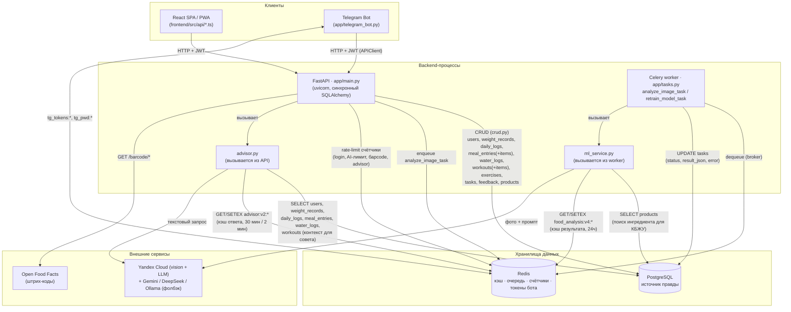

# Взаимодействие БД и бэкенда

Как компоненты бэкенда обращаются к PostgreSQL и Redis: кто пишет, кто читает, через что и зачем.
Общая архитектура — в [architecture.md](architecture.md); эта страница — детализация именно
слоя данных.

## Диаграмма

> Рендерится как диаграмма в любом просмотрщике с поддержкой Mermaid (GitHub, GitLab, большинство
> IDE-плагинов). Растровая копия для быстрого просмотра — см. приложенный к этому обновлению файл
> `db-backend-interaction.svg`, либо откройте эту страницу в предпросмотре Markdown.

## Кто и что читает/пишет в PostgreSQL

| Компонент | Таблицы | Доступ | Зачем |
|---|---|---|---|
| `app/main.py` (через `crud.py`) | `users`, `weight_records`, `daily_logs`, `meal_entries`, `meal_entry_items`, `water_logs`, `workouts`, `workout_items`, `exercises`, `products`, `feedback` | чтение + запись | обслуживает все REST-эндпоинты (профиль, дневник, вода, тренировки, справочники, фидбек) |
| `app/main.py` — создание задачи анализа | `tasks` | INSERT | `POST /analyze` создаёт строку `pending` перед постановкой в очередь Celery |
| `app/main.py` — статус задачи | `tasks` | SELECT | `GET /task/{id}`, `GET /tasks` |
| Celery worker (`app/tasks.py`) | `tasks` | SELECT + UPDATE | переводит статус `pending→processing→success/failure`, пишет `result_json`/`error` |
| `app/ml_service.py` (`calc_kbju`, вызывается из worker) | `products` | SELECT | подбор нутриентов по названию ингредиента; при отсутствии — оценка по типу, без похода в БД |
| `app/advisor.py` (вызывается из API-процесса, не из worker) | `users`, `weight_records`, `daily_logs`, `meal_entries`, `water_logs`, `workouts` | SELECT | собирает контекст пользователя (нормы, сегодняшний дневник, вода, тренировки, тренд веса) перед обращением к LLM |
| `app/seed_products.py`, `app/seed_exercises.py` (запускаются при старте API) | `products`, `exercises` | INSERT (идемпотентно) | наполняют справочники при первом запуске |
| `app/database.py` (`ensure_schema`, при старте API) | все таблицы (DDL) | `CREATE TABLE`/`ALTER TABLE`/`CREATE INDEX` | ручная «миграция» вместо Alembic — создаёт недостающие таблицы/колонки/индексы |
| `training_data/generate_dataset.py` (Celery `retrain_model_task`, сейчас нерабочий) | `feedback` | SELECT | должен собирать датасет для переобучения; см. [аудит кода](code_audit.md) — сейчас падает на несуществующей настройке |

Таблицы `meals`, `meal_items`, `photos` существуют в схеме (legacy), но ни один текущий
эндпоинт их не читает и не пишет.

## Кто и что использует в Redis (не БД, но критичная часть слоя данных)

| Назначение | Ключи | Кто пишет | Кто читает | TTL |
|---|---|---|---|---|
| Очередь задач Celery (broker/backend) | внутренние ключи Celery | `app/main.py` (`.delay(...)`) | Celery worker | — |
| Кэш результата анализа фото | `food_analysis:v4:<PROMPT_VERSION>:<sha256>` | `ml_service.py` (в worker) | `ml_service.py` (в worker) | 24 ч |
| Кэш ответа AI-советчика | `advisor:v2:{user_id}:{date}:{fingerprint}` | `advisor.py` (в API-процессе) | `advisor.py` | 30 мин (LLM) / 2 мин (фолбэк) |
| Счётчики rate-limit | `ratelimit:*` (+ in-memory fallback) | `app/rate_limit.py` | `app/rate_limit.py` | по окну лимита |
| Токены Telegram-аккаунтов | `tg_tokens:{user_id}` (hash: access/refresh) | `app/telegram_bot.py` | `app/telegram_bot.py`, `app/api_client.py` | пока не разлогинен/не истёк refresh |
| Пароли Telegram-аккаунтов | `tg_pwd:{user_id}` | `app/telegram_bot.py` (при регистрации) | `app/telegram_bot.py` (при логине) | бессрочно |

Redis нигде не является источником правды для доменных данных пользователя — это либо
очередь, либо кэш (переживший сброс Redis результат просто пересчитается/перезапросится), кроме
Telegram-токенов/паролей, которые теряются при полной очистке Redis (бот выдаст пользователю
запрос перелогиниться — некритично, аккаунт в PostgreSQL не теряется).

## Важные детали для понимания потока

1. **FastAPI и Celery worker — разные процессы, но одна и та же БД.** Оба напрямую открывают
   соединение с PostgreSQL через один и тот же `app/database.py` (`SessionLocal`), у каждого свой
   пул соединений (`DB_POOL_SIZE`/`DB_MAX_OVERFLOW` — при масштабировании процессов не забывайте
   считать суммарный лимит против `max_connections` Postgres).
2. **`ml_service.py` не пишет в БД пользовательские данные** — единственное чтение из PostgreSQL,
   которое оно делает, это подбор нутриентов в `products`. Запись результата анализа обратно в
   `tasks` делает вызывающий код в `app/tasks.py`, а не сам `ml_service`.
3. **`advisor.py` выполняется в процессе FastAPI**, а не в Celery — LLM-вызов советчика идёт через
   отдельный пул потоков (`ADVISOR_MAX_CONCURRENCY`), чтобы не занимать общий threadpool FastAPI
   (иначе много одновременных запросов советчика подвесили бы `/login` и `/health`).
4. **`ensure_schema()` — не миграция в привычном смысле.** Alembic в проекте нет; при первом
   запуске API идемпотентно создаются недостающие таблицы/колонки/индексы. Опасно откатывать
   изменения полей — только добавление.

См. также: [architecture.md](architecture.md), [data-models.md](../requirements/data-models.md),
[task_lifecycle.md](task_lifecycle.md).
